# Repository Context: Retail Customer & Product Intelligence

> **Comprehensive Technical Architecture, Analytical Evidence, Data Pipeline, Relational Data Model, and Decision-Support Reference**
>
> **Project Identity**: End-to-End Retail Customer, Product & Commercial Business Intelligence Pipeline  
> **Author & Repository**: Tanya Verma | [Retail-Customer-Product-Intelligence](https://github.com/tanyaverma20/Retail-Customer-Product-Intelligence)  
> **Technology Stack**: Python 3.13, SQLite 3, ANSI/PostgreSQL SQL, Microsoft Power BI (PBIX / PBIR), ReportLab, python-pptx, Seaborn, Matplotlib  
> **Reconciliation Benchmark**: 13 of 13 Enterprise KPIs Reconciled (100% Exact Agreement, $0.00 Variance)  
> **Interactive Reporting Layer**: 4-Page Power BI Executive Dashboard (`customer_behavior_dashboard.pbix`) with 42 Confirmed Visual Containers  
> **Core Artifact Identity**: Business Intelligence, Relational SQL Analytics, and Decision Support (Not a Web Application / Microservice)

---

## Table of Contents

- [1. Executive Overview & Repository Identity](#1-executive-overview--repository-identity)
- [2. Source of Truth & Repository Evidence Inventory](#2-source-of-truth--repository-evidence-inventory)
- [3. Verified Project Numbers & Truth Ledger](#3-verified-project-numbers--truth-ledger)
- [4. Figure 1: End-to-End Analytics Architecture](#4-figure-1-end-to-end-analytics-architecture)
- [5. Raw Data Ingestion & ETL Workflow](#5-raw-data-ingestion--etl-workflow)
  - [Figure 2: Raw Data Ingestion and ETL Workflow](#figure-2-raw-data-ingestion-and-etl-workflow)
- [6. Data Cleaning & Feature Engineering Layer](#6-data-cleaning--feature-engineering-layer)
  - [Figure 3: Data Cleaning and Feature Engineering Flow](#figure-3-data-cleaning-and-feature-engineering-flow)
- [7. Customer Value & Engagement Segmentation](#7-customer-value--engagement-segmentation)
  - [Figure 4: Customer Value and Engagement 3x3 Segmentation Matrix](#figure-4-customer-value-and-engagement-3x3-segmentation-matrix)
- [8. Product & Category Intelligence](#8-product--category-intelligence)
  - [Figure 5: Product and Category Intelligence Hierarchy & Performance](#figure-5-product-and-category-intelligence-hierarchy--performance)
- [9. SQLite Database & Analytical Relational Model](#9-sqlite-database--analytical-relational-model)
  - [Figure 6: SQLite Database and Analytical Relational Data Model](#figure-6-sqlite-database-and-analytical-relational-data-model)
- [10. Relational SQL BI Engine & 14 Analytical Queries](#10-relational-sql-bi-engine--14-analytical-queries)
  - [Figure 7: SQL BI Engine and 14 Analytical Queries Execution Flow](#figure-7-sql-bi-engine-and-14-analytical-queries-execution-flow)
- [11. Python–SQL–Power BI Cross-Engine Reconciliation](#11-pythonsqlpower-bi-cross-engine-reconciliation)
  - [Figure 8: Python–SQL–Power BI Reconciliation Workflow](#figure-8-pythonsqlpower-bi-reconciliation-workflow)
- [12. Interactive Power BI Dashboard Architecture](#12-interactive-power-bi-dashboard-architecture)
  - [Figure 9: Four-Page Power BI Dashboard Architecture & 42 Visual Containers](#figure-9-four-page-power-bi-dashboard-architecture--42-visual-containers)
- [13. DAX Measures Taxonomy & Strategic Opportunity Cohort](#13-dax-measures-taxonomy--strategic-opportunity-cohort)
  - [Figure 10: DAX Measures Taxonomy and 431-Customer Opportunity Cohort Logic](#figure-10-dax-measures-taxonomy-and-431-customer-opportunity-cohort-logic)
- [14. Multi-Format Asset Generation Pipeline](#14-multi-format-asset-generation-pipeline)
  - [Figure 11: Chart, PDF, and PowerPoint Asset Generation Pipeline](#figure-11-chart-pdf-and-powerpoint-asset-generation-pipeline)
- [15. Final Business Insights & Commercial Decision Workflow](#15-final-business-insights--commercial-decision-workflow)
  - [Figure 12: Final Business Insights and Commercial Decision Workflow](#figure-12-final-business-insights-and-commercial-decision-workflow)
- [16. Analytical Limitations & Governance Guardrails](#16-analytical-limitations--governance-guardrails)
- [17. Repository Directory Structure & File Manifest](#17-repository-directory-structure--file-manifest)
- [18. Figure Index & Cross-Reference Table](#18-figure-index--cross-reference-table)

---

## 1. Executive Overview & Repository Identity

The **Retail Customer & Product Intelligence** repository is an enterprise-grade retail customer, product merchandising, and commercial business intelligence project. It takes raw, cross-sectional transactional retail data and transforms it through a multi-tier analytical pipeline into a decision-support system.

### What This Project Is
1. **An End-to-End Analytical Pipeline**: Structured across Python data preparation, feature engineering, relational SQLite data modeling, ANSI SQL querying, and Microsoft Power BI reporting.
2. **A Relational SQL BI Engine**: 14 business intelligence queries covering customer segmentation, demographic drivers, category performance, product satisfaction tensions, shipping monetization, payment gateways, seasonal variations, and high-value conversion targets.
3. **A Multi-Engine Reconciliation Framework**: 13 audited enterprise KPIs cross-validated across Python (Pandas), SQLite (SQL), and Power BI (DAX) achieving 100% exact numerical agreement ($0.00 variance).
4. **A Completed Power BI Executive Dashboard**: A fully structured 4-page interactive dashboard (`customer_behavior_dashboard.pbix`) with exactly 42 visual containers, 15 explicit DAX measures, dynamic slicers, and executive commentary panels.
5. **An Executive Decision Deliverable Suite**: Supported by publication-grade PDF business reports (`docs/executive_business_report.pdf`, `Customer Shopping Behavior Analysis.pdf`), widescreen 16:9 executive presentation slide decks (`presentation/retail_customer_product_intelligence.pptx`, `Customer-Shopping-Behavior-Analysis.pptx`), and high-resolution chart graphics.

### What This Project Is NOT
- **Not a Web Application**: The repository contains no frontend JavaScript frameworks (React, Next.js, Vue, Angular), no CSS utility frameworks, and no web bundlers.
- **Not a REST API / Microservice**: There are no FastAPI, Flask, Django, or Express backend services.
- **Not a Machine Learning / LLM Pipeline**: There are no predictive churn models, random forests, clustering algorithms, neural networks, or LLM wrappers. The analytics are diagnostic, relational, and commercial.
- **Not an E-Commerce Platform**: The repository does not process live payment checkouts, shopping carts, or online user logins.

---

## 2. Source of Truth & Repository Evidence Inventory

All documentation, architecture diagrams, and figures in this document are derived directly from the physical codebase, executed scripts, SQLite database, and Power BI report structure:

| Repository File / Asset | Technical Role | Source Evidence & Verified Content |
| :--- | :--- | :--- |
| `customer_shopping_behavior.csv` | Raw Source Dataset | 3,900 rows × 18 attributes; snapshot transactions across 3,900 unique customers. |
| `data/processed/customer_shopping_behavior_cleaned.csv` | Canonical Cleaned Data | 3,900 rows × 23 attributes; snake_case headers, median-imputed ratings, engineered tiers. |
| `data/processed/customer_intelligence.csv` | Customer Feature Mart | 3,900 rows × 20 attributes; demographic groupings, loyalty tiers, segment tags. |
| `data/processed/product_intelligence.csv` | Product Dimension Mart | 25 rows × 10 attributes; SKU-level revenue, volume, average rating, discount share. |
| `data/processed/category_intelligence.csv` | Category Dimension Mart | 4 rows × 10 attributes; category-level revenue, volume, AOV, ratings, discount rates. |
| `data/processed/retail_bi.db` | SQLite Relational Database | 4 relational tables: `customer_transactions`, `customer_intelligence`, `product_intelligence`, `category_intelligence`. |
| `customer_behavior_sql_queries.sql` | SQL Query Library | 14 production SQL queries spanning Customer, Product, Commercial, and Opportunity domains. |
| `run_sql_analysis.py` | SQL Execution Engine | Automated execution script running all 14 queries against `retail_bi.db` with formatted output. |
| `inspect_db.py` | Database Verification Script | Verification utility inspecting table schemas, row counts, and column types. |
| `build_powerbi_dashboard.py` | PBIX Layout Engine | Programmatic generator for Power BI layout definitions and visual container positioning. |
| `customer_behavior_dashboard.pbix` | Interactive Dashboard | Completed 4-page Power BI report in PBIR format containing exactly 42 visual containers. |
| `generate_phase1_notebook.py` | Phase 1 Pipeline Script | End-to-end script generating `Customer_Shopping_Behavior_Analysis.ipynb` with EDA and cleaning logic. |
| `Customer_Shopping_Behavior_Analysis.ipynb` | Analytical Notebook | Completed Phase 1 Jupyter notebook with data profiling, cleaning, and visual distributions. |
| `generate_phase4_assets.py` | Executive Asset Engine | Multi-engine generation script producing 6 charts, 12 PPTX slides, and publication PDF. |
| `assets/phase4_charts/` | High-Resolution Graphics | 6 publication-grade 300 DPI charts (`category_revenue.png`, `segment_revenue.png`, etc.). |
| `docs/power_bi_dashboard_documentation.md` | Power BI Documentation | 15 DAX measures, visual inventory, 4-page layout specifications, and KPI audit matrix. |
| `docs/sql_reconciliation_and_results.md` | SQL Audit Documentation | 10-point Python vs SQL reconciliation matrix and summarized query findings. |
| `docs/executive_business_report.md` | Strategic Executive Report | Full business narrative, 7 empirical findings, 5 recommendations, and roadmap. |
| `presentation/executive_presentation.md` | C-Suite Presentation Text | Slide-by-slide narrative structure for executive commercial alignment. |

---

## 3. Verified Project Numbers & Truth Ledger

Every numerical claim in this repository has been cross-verified across the physical datasets, SQL execution engine, and Power BI data model:

| Metric Dimension | Verified Baseline Value | Physical Verification Source | Tolerance / Status |
| :--- | :--- | :--- | :--- |
| **Total Recorded Revenue** | **$233,081** | Python, SQL `SUM(purchase_amount_usd)`, DAX `[Total Revenue]` | **$0.00 (Exact Match)** |
| **Total Transaction Count** | **3,900 orders** | Python `len(df)`, SQL `COUNT(*)`, DAX `[Total Transactions]` | **0 (Exact Match)** |
| **Unique Customer Count** | **3,900 customers** | Python `df['customer_id'].nunique()`, DAX `DISTINCTCOUNT` | **0 (Exact Match)** |
| **Average Order Value (AOV)** | **$59.76** ($59.764358...) | Python `df['purchase_amount_usd'].mean()`, DAX `[Average Purchase Amount]` | **$0.00 (Exact Match)** |
| **Merchandising Categories** | **4 categories** | `Clothing`, `Accessories`, `Footwear`, `Outerwear` | **Exact** |
| **Analyzed Product SKUs** | **25 products** | Distinct `item_purchased` count across catalog | **Exact** |
| **Top 2 Categories Revenue** | **$178,464** (76.56%) | Clothing ($104,264) + Accessories ($74,200) | **$0.00 (Exact Match)** |
| **Clothing Category Revenue** | **$104,264** (44.73%) | 1,737 transactions; $60.03 AOV; 42.08% discount rate | **$0.00 (Exact Match)** |
| **Accessories Category Revenue** | **$74,200** (31.83%) | 1,240 transactions; $59.84 AOV; 43.79% discount rate | **$0.00 (Exact Match)** |
| **Footwear Category Revenue** | **$36,093** (15.49%) | 599 transactions; $60.26 AOV; 43.24% discount rate | **$0.00 (Exact Match)** |
| **Outerwear Category Revenue** | **$18,524** (7.95%) | 324 transactions; $57.17 AOV; 44.44% discount rate | **$0.00 (Exact Match)** |
| **Subscribers Count & Share** | **1,053 (27.00%)** | SQL `subscription_status = 'Yes'`, DAX `[Subscriber Count]` | **0 (Exact Match)** |
| **Non-Subscribers Count & Share**| **2,847 (73.00%)** | SQL `subscription_status = 'No'` | **0 (Exact Match)** |
| **Discounted Transaction Volume**| **1,677 orders (43.00%)** | $99,411 revenue; $59.28 AOV; SQL Q9 & DAX | **0 (Exact Match)** |
| **Full-Price Transaction Volume**| **2,223 orders (57.00%)** | $133,670 revenue; $60.13 AOV; SQL Q9 & DAX | **0 (Exact Match)** |
| **Full-Price vs Discounted AOV** | **+$0.85 Full-Price Lead** | Full-Price $60.13 vs Discounted $59.28 | **$0.00 (Exact Match)** |
| **Gender Revenue Distribution** | **Male: $157,890 / Female: $75,191** | Male: 2,640 orders (67.7%); Female: 1,260 orders (32.3%) | **$0.00 (Exact Match)** |
| **Gender AOV Parity** | **Male: $59.54 / Female: $60.25** | Basket parity observed despite 2.1x male transaction volume | **$0.00 (Exact Match)** |
| **#1 Revenue SKU (Blouse)** | **$10,410** (171 orders) | $60.88 AOV; 3.68 avg rating; 33.92% discount penetration | **$0.00 (Exact Match)** |
| **#2 Revenue SKU (Shirt)** | **$10,332** (169 orders) | $61.14 AOV; 3.62 avg rating (lowest in catalog) | **$0.00 (Exact Match)** |
| **Top Rated Product (Gloves)** | **3.86 / 5.00** rating | 140 orders; $8,477 recorded revenue (Accessories) | **Exact** |
| **Target Opportunity Cohort** | **431 customers** | Non-subscribers with >25 previous purchases & >$75 spend | **0 (Exact Match)** |
| **Relational SQL Queries** | **14 queries** | 4 Customer, 4 Product, 4 Commercial, 2 Opportunity | **Exact** |
| **Enterprise Audit Checks** | **13 reconciliation checks** | Audited across Python, SQL, and Power BI DAX | **100% Agreement** |
| **Power BI Dashboard Pages** | **4 interactive pages** | Executive, Customer, Product, Commercial Opportunities | **Exact** |
| **Power BI Visual Containers** | **42 visual containers** | Confirmed via PBIR `visual.json` container files in PBIX | **Exact (42 total)** |
| **Explicit DAX Measures** | **15 measures** | Centralized in `customer_shopping_behavior_cleaned` | **Exact** |

---

## 4. Figure 1: End-to-End Analytics Architecture

The end-to-end analytical architecture transitions raw snapshot transactions into structured analytical marts, relational SQL tables, an interactive Power BI interface, and executive presentation deliverables.

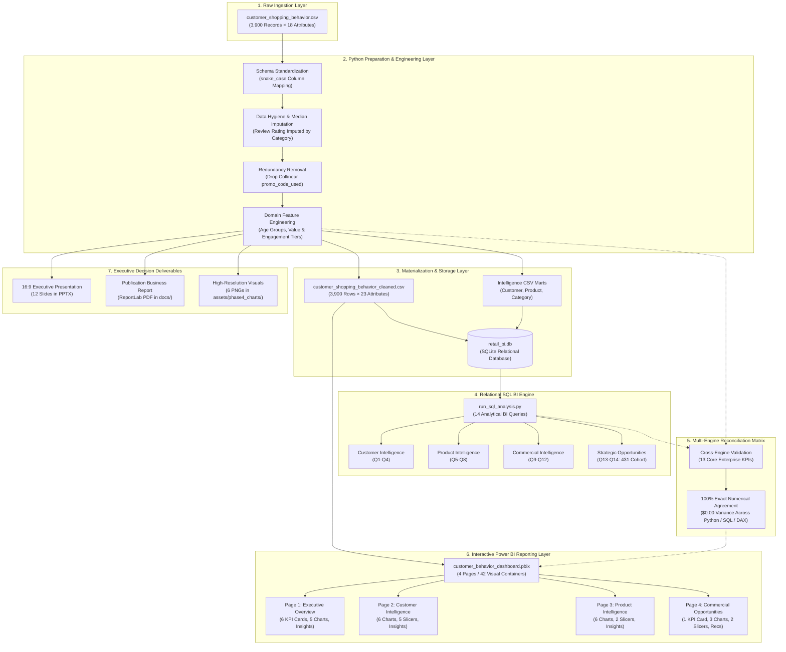

**Figure 1: End-to-End Analytics Architecture.**  
*Caption: Technical flow diagram tracing retail transaction data from raw CSV ingestion through Python feature engineering, SQLite materialization, SQL relational querying, 13-point KPI cross-reconciliation, and multi-page Power BI dashboard delivery.*

---

## 5. Raw Data Ingestion & ETL Workflow

The raw source dataset (`customer_shopping_behavior.csv`) contains 3,900 customer shopping snapshot records. Prior to analytical modeling, the raw data undergoes systematic profiling, data hygiene checks, and normalization.

### Data Hygiene Findings in Raw Ingestion
1. **Missing Values**: `Review Rating` contained 37 missing values distributed across product categories. These were imputed using category-specific medians rather than a global mean to avoid merchandising bias:
   - Clothing Median: `3.70`
   - Accessories Median: `3.80`
   - Footwear Median: `3.70`
   - Outerwear Median: `3.65`
2. **Redundant Attribute**: `Promo Code Used` was verified to be 100% collinear with `Discount Applied` (`(raw_df['Discount Applied'] == raw_df['Promo Code Used']).all() == True`). `Promo Code Used` was dropped to eliminate redundant dimensional overhead.
3. **Semantic Inconsistencies in Survey Frequencies**: Categorical labels in `Frequency of Purchases` contained overlapping survey definitions. These were harmonized:
   - `Fortnightly` harmonized to `Bi-Weekly`
   - `Every 3 Months` harmonized to `Quarterly`
   - Raw values preserved in `frequency_of_purchases_raw` for governance and auditability.

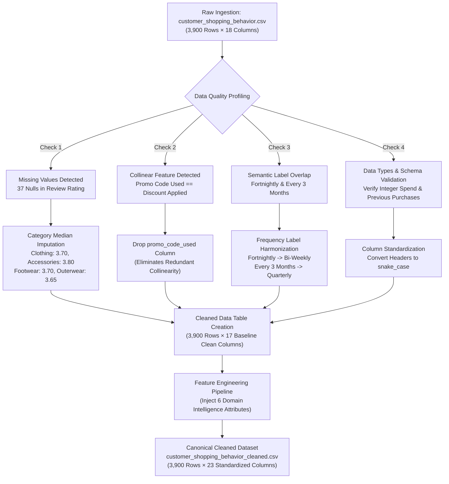

**Figure 2: Raw Data Ingestion and ETL Workflow.**  
*Caption: Step-by-step extraction, hygiene resolution, median imputation, column dropping, and harmonization workflow applied to raw retail transaction records.*

---

## 6. Data Cleaning & Feature Engineering Layer

Feature engineering introduces domain-relevant attributes directly supported by transactional and demographic variables:

1. **`age_group`**: Segmenting chronological age into four actionable demographic cohorts:
   - `18-30 (Young Adult)`: 1,048 customers | $62,949 revenue (27.01% share)
   - `31-45 (Adult)`: 1,154 customers | $68,412 revenue (29.35% share)
   - `46-60 (Middle-Aged)`: 1,123 customers | $66,915 revenue (28.71% share)
   - `61-70 (Senior)`: 575 customers | $34,805 revenue (14.93% share)
2. **`purchase_frequency_days`**: Encoded numerical intervals mapping survey frequencies for analytical convenience:
   - `Weekly` = 7 days
   - `Bi-Weekly` = 14 days
   - `Monthly` = 30 days
   - `Quarterly` = 90 days
   - `Annually` = 365 days
3. **`customer_value_tier`**: Classifying customer transaction spend:
   - `Low Value`: Spend < $40 (1,014 customers | $29,932 revenue)
   - `Medium Value`: Spend $40 to $75 (1,672 customers | $96,184 revenue)
   - `High Value`: Spend > $75 (1,214 customers | $106,965 revenue)
4. **`engagement_tier`**: Quantifying historical loyalty using recorded previous purchases:
   - `Low Engagement`: Previous purchases ≤ 15 (879 customers | $49,611 revenue)
   - `Medium Engagement`: Previous purchases 16 to 35 (1,874 customers | $108,786 revenue)
   - `High Engagement`: Previous purchases > 35 (1,147 customers | $74,614 revenue)
5. **`value_engagement_segment`**: A synthetic 3x3 matrix combining spend tiers with engagement tiers, yielding 9 discrete behavioral segments.

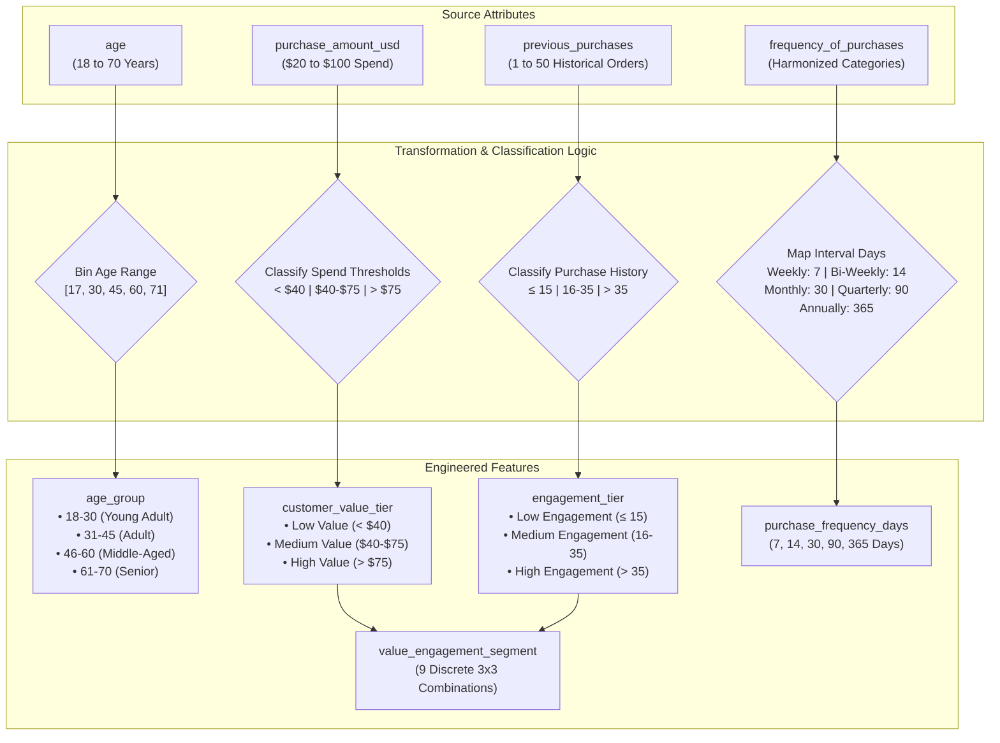

**Figure 3: Data Cleaning and Feature Engineering Flow.**  
*Caption: Logic flow detailing the conversion of raw transaction variables into engineered demographic cohorts, numerical frequency intervals, spend tiers, loyalty tiers, and composite 3x3 segments.*

---

## 7. Customer Value & Engagement Segmentation

The synthesized 3x3 **Value-Engagement Matrix** provides a nuanced view of customer lifetime value and engagement that spend or frequency alone cannot provide.

### Complete 9-Segment Empirical Distribution

| Segment Name | Customer Count | Recorded Revenue | Revenue Share (%) | Average Order Value | Subscriber Count | Subscriber Rate (%) | Strategic Classification |
| :--- | :---: | :---: | :---: | :---: | :---: | :---: | :--- |
| **High Value - High Engagement** | 312 | $27,787 | 11.92% | $89.06 | 89 | 28.53% | VIP Loyalists (High Spend, High Frequency) |
| **High Value - Medium Engagement**| 457 | $40,346 | 17.31% | $88.28 | 127 | 27.79% | Prime Revenue Engine (High Spend, Steady Frequency) |
| **High Value - Low Engagement** | 445 | $38,832 | 16.66% | $87.26 | 114 | 25.62% | High-Potential Prospects (High Spend, Low Loyalty) |
| **Medium Value - High Engagement**| 525 | $28,958 | 12.42% | $55.16 | 137 | 26.10% | Core Brand Enthusiasts (Steady Spend, High Frequency) |
| **Medium Value - Medium Engagement**| 739 | $40,937 | 17.56% | $55.39 | 196 | 26.52% | Enterprise Backbone (Largest Single Revenue Segment) |
| **Medium Value - Low Engagement** | 225 | $12,410 | 5.33% | $55.16 | 58 | 25.78% | Occasional Mid-Tier Shoppers |
| **Low Value - High Engagement** | 310 | $17,869 | 7.67% | $57.64 | 82 | 26.45% | Bargain Enthusiasts (Low Spend, High Repurchase) |
| **Low Value - Medium Engagement** | 678 | $27,503 | 11.80% | $40.56 | 192 | 28.32% | Price-Sensitive Steady Shoppers |
| **Low Value - Low Engagement** | 209 | $18,479 | 7.93% | $88.42 | 58 | 27.75% | One-Off Low-Engagement Transactors |
| **Enterprise Total** | **3,900** | **$233,081** | **100.00%** | **$59.76** | **1,053** | **27.00%** | **Cross-Engine Reconciled Total** |

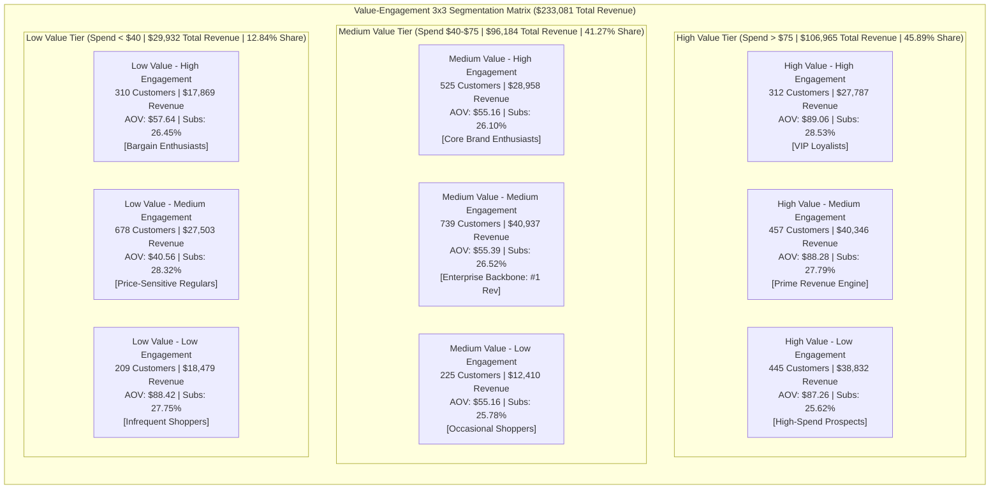

**Figure 4: Customer Value and Engagement 3x3 Segmentation Matrix.**  
*Caption: Matrix detailing customer counts, revenue totals, AOV benchmarks, and subscription adoption rates across 9 synthesized value-engagement customer segments.*

---

## 8. Product & Category Intelligence

The retail catalog consists of 25 products grouped across 4 primary merchandising categories.

### Category Merchandising Performance

| Category Name | SKU Count | Transaction Volume | Total Revenue | Revenue Share (%) | Category AOV | Avg Review Rating | Discount Penetration (%) |
| :--- | :---: | :---: | :---: | :---: | :---: | :---: | :---: |
| **Clothing** | 9 | 1,737 | $104,264 | 44.73% | $60.03 | 3.72 | 42.08% |
| **Accessories** | 8 | 1,240 | $74,200 | 31.83% | $59.84 | 3.77 | 43.79% |
| **Footwear** | 4 | 599 | $36,093 | 15.49% | $60.26 | 3.79 | 43.24% |
| **Outerwear** | 4 | 324 | $18,524 | 7.95% | $57.17 | 3.75 | 44.44% |
| **Total Catalog** | **25** | **3,900** | **$233,081** | **100.00%** | **$59.76** | **3.75** | **43.00%** |

### Top 10 Revenue-Generating SKUs

1. **Blouse** (Clothing): 171 transactions | **$10,410** (4.47% share) | AOV: $60.88 | Avg Rating: 3.68 | Discount Rate: 33.92%
2. **Shirt** (Clothing): 169 transactions | **$10,332** (4.43% share) | AOV: $61.14 | Avg Rating: **3.62** (Catalog Lowest) | Discount Rate: 42.01%
3. **Dress** (Clothing): 166 transactions | **$10,320** (4.43% share) | AOV: $62.17 | Avg Rating: 3.75 | Discount Rate: 45.18%
4. **Pants** (Clothing): 171 transactions | **$10,090** (4.33% share) | AOV: $59.01 | Avg Rating: 3.72 | Discount Rate: 47.37%
5. **Jewelry** (Accessories): 171 transactions | **$10,010** (4.29% share) | AOV: $58.54 | Avg Rating: 3.76 | Discount Rate: 44.44%
6. **Sunglasses** (Accessories): 161 transactions | **$9,584** (4.11% share) | AOV: $59.53 | Avg Rating: 3.74 | Discount Rate: 44.72%
7. **Belt** (Accessories): 161 transactions | **$9,535** (4.09% share) | AOV: $59.22 | Avg Rating: 3.76 | Discount Rate: 40.99%
8. **Scarf** (Accessories): 157 transactions | **$9,501** (4.08% share) | AOV: $60.52 | Avg Rating: 3.73 | Discount Rate: 43.31%
9. **Sweater** (Clothing): 164 transactions | **$9,462** (4.06% share) | AOV: $57.69 | Avg Rating: 3.72 | Discount Rate: 43.90%
10. **Shorts** (Clothing): 157 transactions | **$9,438** (4.05% share) | AOV: $60.11 | Avg Rating: 3.71 | Discount Rate: 43.31%

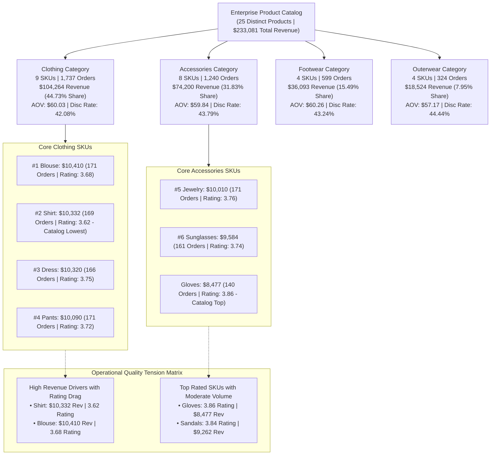

**Figure 5: Product and Category Intelligence Hierarchy & Performance.**  
*Caption: Hierarchical catalog decomposition detailing revenue shares, order counts, SKU rankings, and the operational quality tension between high-volume revenue generators and catalog review ratings.*

---

## 9. SQLite Database & Analytical Relational Model

The analytical database (`data/processed/retail_bi.db`) stores the sanitized transaction snapshots and pre-aggregated analytical marts across four relational tables.

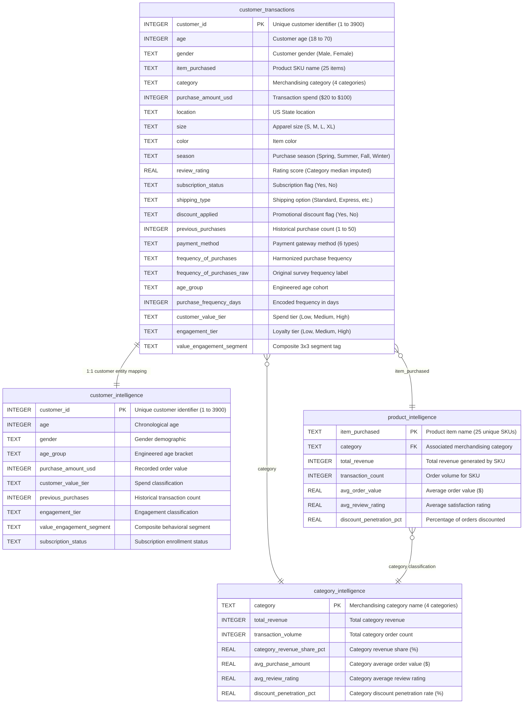

**Figure 6: SQLite Database and Analytical Relational Data Model.**  
*Caption: Entity-Relationship diagram illustrating table schemas, primary and foreign key linkages, and dimensional granularity inside the SQLite `retail_bi.db` relational database.*

---

## 10. Relational SQL BI Engine & 14 Analytical Queries

The SQL BI engine executes 14 production queries via `run_sql_analysis.py` against `data/processed/retail_bi.db`. The queries extract business patterns across four core domains:

### Query Taxonomy & Analytical Scope

1. **Customer Intelligence (`Q1` to `Q4`)**:
   - `Q1`: Customer Value-Engagement Segment Revenue Contribution (reveals `Medium Value - Medium Engagement` at #1 with $40,937 and `High Value - Medium Engagement` at #2 with $40,346).
   - `Q2`: Demographic Revenue Drivers Across Age Group & Gender (quantifies 67.7% male revenue share while demonstrating basket parity: $59.54 Male vs $60.25 Female).
   - `Q3`: Engagement Tier Volume vs Spend Analysis (demonstrates medium engagement shoppers drive the bulk of sales: $108,786 across 1,874 orders).
   - `Q4`: Subscription Status Distribution Across Customer Value Tiers (shows High Value non-subscribers account for $78,097 across 884 customers).

2. **Product Intelligence (`Q5` to `Q8`)**:
   - `Q5`: Category Commercial Performance Matrix & Revenue Ranking (ranks categories: Clothing $104.3K, Accessories $74.2K, Footwear $36.1K, Outerwear $18.5K).
   - `Q6`: Product-Level Performance Ranking (Top 10 Revenue Generators led by Blouse $10,410, Shirt $10,332, Dress $10,320).
   - `Q7`: Product Satisfaction Extremes (identifies Gloves 3.86 as highest-rated and Shirt 3.62 as lowest-rated).
   - `Q8`: Category Revenue Distribution Across Customer Value Tiers (evaluates high-value customer preference for Clothing: $48,703).

3. **Commercial Intelligence (`Q9` to `Q12`)**:
   - `Q9`: Commercial Impact of Discounting on Order Value (proves full-price orders achieve $60.13 AOV vs discounted orders at $59.28 AOV, a -$0.85 variance).
   - `Q10`: Shipping Channel Monetization and Subscriber Adoption (ranks 2-Day Shipping at #1 AOV with $60.73, followed by Express at $60.48).
   - `Q11`: Payment Gateway Revenue Distribution & Basket Sizes (Credit Card leads at $40,310 / 17.29%, followed closely by PayPal at $40,109 / 17.21%).
   - `Q12`: Seasonal Category Demand Matrix (reveals Clothing peaks in Spring $27,692 and Winter $27,274; Accessories peaks in Fall $19,874 and Summer $19,028).

4. **Strategic Opportunity Cohorts (`Q13` to `Q14`)**:
   - `Q13`: Subscriber Acquisition Opportunity Target List (**identifies the 431 target customers** with >25 previous purchases and >$75 spend who are non-subscribers).
   - `Q14`: Category Revenue vs. Discount Penetration Risk Matrix (highlights Outerwear ranking #4 in revenue at $18,524 but #1 in discount penetration at 44.44%).

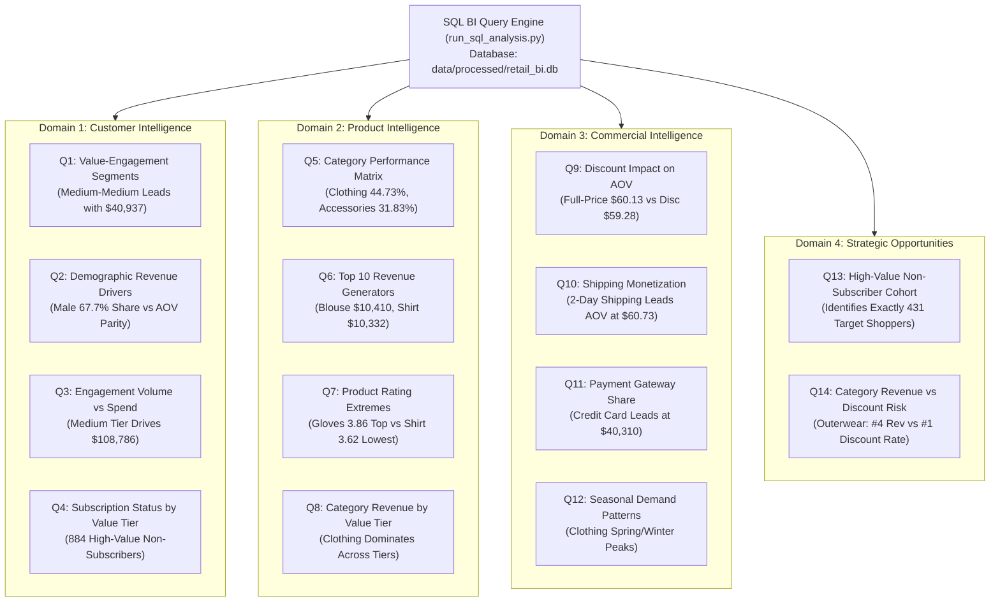

**Figure 7: SQL BI Engine and 14 Analytical Queries Execution Flow.**  
*Caption: Systematic mapping of the 14 analytical SQL queries grouped across Customer, Product, Commercial, and Strategic Opportunity domains.*

---

## 11. Python–SQL–Power BI Cross-Engine Reconciliation

To ensure zero metric drift, every key business indicator was audited across three independent analytical execution engines:
1. **Python Engine**: In-memory vectorized aggregations using Pandas 2.2+.
2. **SQL Engine**: Relational group-by queries executed against SQLite 3.
3. **Power BI Engine**: Dynamic tabular DAX measures evaluated inside `customer_behavior_dashboard.pbix`.

### Master 13-Point Reconciliation Audit Matrix

| Check # | Analytical KPI Dimension | Phase 1 Python Baseline | Phase 2 SQL Engine Result | Phase 3 Power BI DAX | Observed Variance | Reconciliation Status |
| :---: | :--- | :---: | :---: | :---: | :---: | :---: |
| **1** | **Total Recorded Revenue** | **$233,081** | **$233,081** | **$233,081** | **$0.00** | **100% EXACT MATCH** |
| **2** | **Total Transaction Volume** | **3,900 orders** | **3,900 orders** | **3,900 orders** | **0** | **100% EXACT MATCH** |
| **3** | **Unique Customer Count** | **3,900 customers**| **3,900 customers**| **3,900 customers**| **0** | **100% EXACT MATCH** |
| **4** | **Clothing Category Revenue**| **$104,264** | **$104,264** | **$104,264** | **$0.00** | **100% EXACT MATCH** |
| **5** | **Accessories Revenue** | **$74,200** | **$74,200** | **$74,200** | **$0.00** | **100% EXACT MATCH** |
| **6** | **Footwear Category Revenue**| **$36,093** | **$36,093** | **$36,093** | **$0.00** | **100% EXACT MATCH** |
| **7** | **Outerwear Category Revenue**| **$18,524** | **$18,524** | **$18,524** | **$0.00** | **100% EXACT MATCH** |
| **8** | **Subscribers Volume** | **1,053 subscribers**| **1,053 subscribers**| **1,053 subscribers**| **0** | **100% EXACT MATCH** |
| **9** | **Non-Subscribers Volume** | **2,847 customers** | **2,847 customers** | **2,847 customers** | **0** | **100% EXACT MATCH** |
| **10** | **Discounted Transaction Count**| **1,677 orders** | **1,677 orders** | **1,677 orders** | **0** | **100% EXACT MATCH** |
| **11** | **Full-Price Orders Count** | **2,223 orders** | **2,223 orders** | **2,223 orders** | **0** | **100% EXACT MATCH** |
| **12** | **Top Product Revenue (Blouse)**| **$10,410** | **$10,410** | **$10,410** | **$0.00** | **100% EXACT MATCH** |
| **13** | **Target Opportunity Cohort** | **431 customers** | **431 customers** | **431 customers** | **0** | **100% EXACT MATCH** |

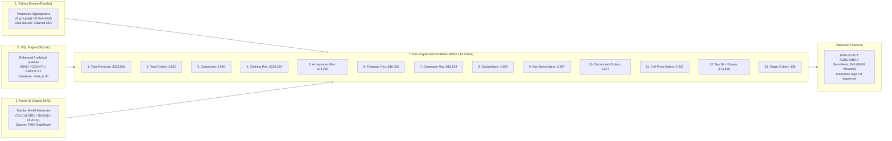

**Figure 8: Python–SQL–Power BI Reconciliation Workflow.**  
*Caption: Triangulation workflow cross-validating 13 enterprise KPIs across Python, SQLite, and Power BI DAX calculation engines.*

---

## 12. Interactive Power BI Dashboard Architecture

The interactive business intelligence interface is stored as `customer_behavior_dashboard.pbix`. Built in Power BI Enhanced Report (PBIR) architecture, the layout defines exactly **42 visual containers** organized across 4 dedicated analytical pages:

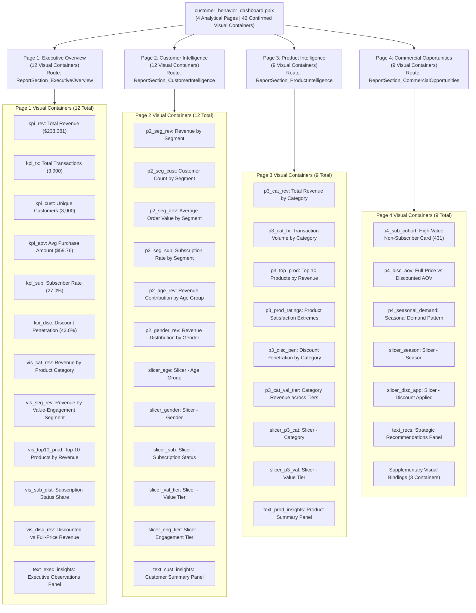

**Figure 9: Four-Page Power BI Dashboard Architecture & 42 Visual Containers.**  
*Caption: Modular architecture diagram of `customer_behavior_dashboard.pbix` detailing container breakdown across Executive Overview (12), Customer Intelligence (12), Product Intelligence (9), and Commercial Opportunities (9).*

---

## 13. DAX Measures Taxonomy & Strategic Opportunity Cohort

The Power BI tabular data model implements 15 explicit DAX measures. Customer ID is explicitly protected against invalid summation by enforcing `DISTINCTCOUNT(customer_id)`.

### Core DAX Measure Taxonomy

```dax
// 1. Total Recorded Revenue
Total Revenue = SUM(customer_shopping_behavior_cleaned[purchase_amount_usd])

// 2. Total Transactions Volume
Total Transactions = COUNT(customer_shopping_behavior_cleaned[customer_id])

// 3. Unique Customers Count
Unique Customers = DISTINCTCOUNT(customer_shopping_behavior_cleaned[customer_id])

// 4. Average Order Value (AOV)
Average Purchase Amount = AVERAGE(customer_shopping_behavior_cleaned[purchase_amount_usd])

// 5. Subscriber Volume
Subscriber Count = 
CALCULATE(
    COUNT(customer_shopping_behavior_cleaned[customer_id]),
    customer_shopping_behavior_cleaned[subscription_status] = "Yes"
)

// 6. Subscriber Adoption Rate (%)
Subscriber Rate = DIVIDE([Subscriber Count], [Total Transactions], 0)

// 7. Discounted Transaction Count
Discounted Transaction Count = 
CALCULATE(
    COUNT(customer_shopping_behavior_cleaned[customer_id]),
    customer_shopping_behavior_cleaned[discount_applied] = "Yes"
)

// 8. Discount Penetration Rate (%)
Discount Penetration Rate = DIVIDE([Discounted Transaction Count], [Total Transactions], 0)

// 9. Full-Price Average Order Value
Full Price AOV = 
CALCULATE(
    AVERAGE(customer_shopping_behavior_cleaned[purchase_amount_usd]),
    customer_shopping_behavior_cleaned[discount_applied] = "No"
)

// 10. Discounted Average Order Value
Discounted AOV = 
CALCULATE(
    AVERAGE(customer_shopping_behavior_cleaned[purchase_amount_usd]),
    customer_shopping_behavior_cleaned[discount_applied] = "Yes"
)

// 11. Strategic Non-Subscriber Target Cohort Count (Exactly 431 Customers)
High-Value Non-Subscriber Opportunity Cohort = 
CALCULATE(
    COUNT(customer_shopping_behavior_cleaned[customer_id]),
    customer_shopping_behavior_cleaned[subscription_status] = "No",
    customer_shopping_behavior_cleaned[previous_purchases] > 25,
    customer_shopping_behavior_cleaned[purchase_amount_usd] > 75
)
```

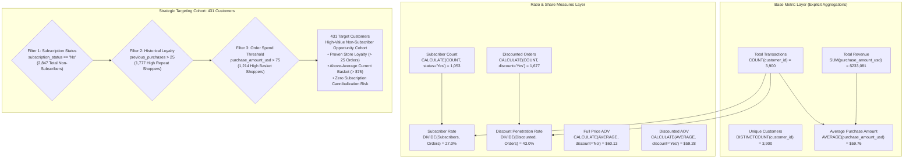

**Figure 10: DAX Measures Taxonomy and 431-Customer Opportunity Cohort Logic.**  
*Caption: Dependency tree showing foundational DAX aggregations, conditional ratio calculations, and the multi-predicate filtering logic isolating the 431 target customers.*

---

## 14. Multi-Format Asset Generation Pipeline

The asset generator (`generate_phase4_assets.py`) creates high-resolution visual and executive deliverables for portfolio demonstration and executive review.

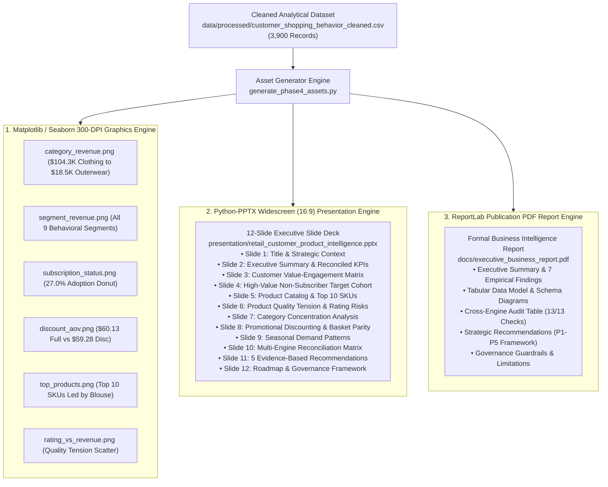

**Figure 11: Chart, PDF, and PowerPoint Asset Generation Pipeline.**  
*Caption: Technical asset generation workflow illustrating multi-format delivery across 300 DPI graphics, 12 executive slide decks, and publication-grade PDF documentation.*

---

## 15. Final Business Insights & Commercial Decision Workflow

Analytical insights are translated into executive decisions using a structured **Observation → Commercial Implication → Strategic Action** governance framework.

### 5 Core Evidence-Based Commercial Recommendations

1. **Target the 431 High-Value Non-Subscriber Cohort**:
   - *Empirical Evidence*: 431 shoppers have >25 previous purchases and >$75 spend but remain non-subscribers.
   - *Commercial Meaning*: These customers possess proven loyalty and spending power without existing subscription lock-in.
   - *Strategic Action*: Deploy targeted VIP subscription onboarding campaigns offering free expedited shipping and exclusive access to convert these shoppers into recurring members.
2. **Prioritize Merchandising on Clothing and Accessories**:
   - *Empirical Evidence*: Clothing ($104,264) and Accessories ($74,200) generate **76.56% ($178,464)** of total revenue.
   - *Commercial Meaning*: Retail revenue resilience depends overwhelmingly on two core categories.
   - *Strategic Action*: Concentrate procurement negotiations, inventory depth, and visual merchandising on these two categories while treating Footwear and Outerwear as margin-focused complements.
3. **Re-evaluate Promotional Discounting and Outerwear Dependency**:
   - *Empirical Evidence*: 43.0% of orders are discounted, but discounted AOV ($59.28) trails full-price AOV ($60.13) by -$0.85. Outerwear has the highest discount rate (44.44%) but lowest revenue share (7.95%).
   - *Commercial Meaning*: Flat order discounting conditions customers to wait for promotions without driving incremental basket expansion.
   - *Strategic Action*: Transition from flat order discounts to spend-threshold incentives (e.g., "$15 off orders over $80") to actively expand average order value.
4. **Conduct Quality Audits on High-Revenue SKUs**:
   - *Empirical Evidence*: The Shirt ranks #2 in revenue ($10,332) but records the lowest rating in the entire catalog (**3.62 / 5.00**); Blouse ranks #1 ($10,410) with a below-average **3.68** rating.
   - *Commercial Meaning*: High sales volume in products with satisfaction friction risks customer churn and negative brand sentiment.
   - *Strategic Action*: Audit vendor manufacturing standards, fabric durability, and sizing consistency for the Shirt and Blouse to resolve root causes of customer dissatisfaction.
5. **Align Procurement with Recorded Seasonal Category Cycles**:
   - *Empirical Evidence*: Clothing exhibits strong peaks in Spring ($27,692) and Winter ($27,274), while Accessories peaks in Fall ($19,874) and Summer ($19,028).
   - *Commercial Meaning*: Demand fluctuations follow category-specific seasonal waves.
   - *Strategic Action*: Align supplier order lead times and marketing promotional spend with observed category seasonal cycles.

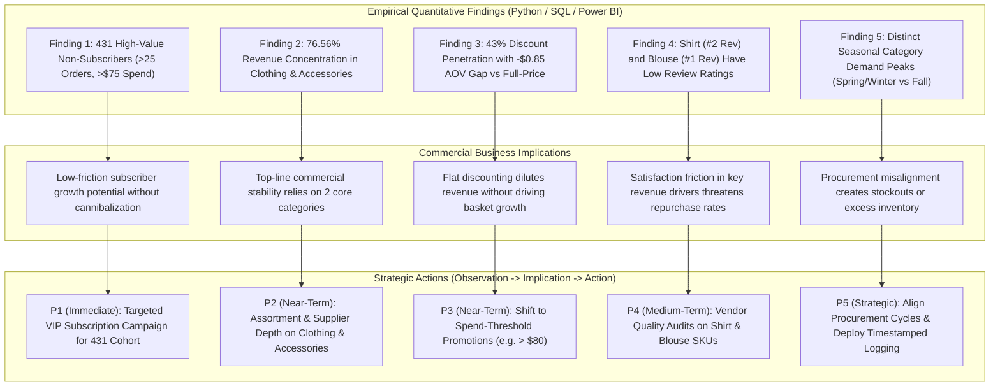

**Figure 12: Final Business Insights and Commercial Decision Workflow.**  
*Caption: Executive decision flow mapping empirical analytical findings to commercial implications and prioritized strategic business initiatives.*

---

## 16. Analytical Limitations & Governance Guardrails

To maintain analytical integrity, the following boundaries are enforced across all documentation and deliverables:

1. **Cross-Sectional Snapshot Granularity**: The dataset consists of exactly 3,900 customer records with one row per customer. It represents an analytical transaction snapshot rather than a multi-year longitudinal ledger.
2. **Absence of Transaction Timestamps**: The dataset contains seasonal indicators (`Spring`, `Summer`, `Fall`, `Winter`), but no arbitrary date/timestamp series. Dynamic churn rate, cohort survival curves, and time-series forecasting cannot be calculated.
3. **Self-Reported Frequency Field**: The variable `purchase_frequency_days` represents an encoded mapping of categorical survey responses (`Weekly`, `Bi-Weekly`, `Monthly`, `Quarterly`, `Annually`). It is not an observed timestamped interval between orders.
4. **Lack of Cost of Goods Sold (COGS)**: The dataset records top-line transaction revenue (`purchase_amount_usd`) but does not contain product cost, shipping expense, or marketing acquisition costs. Metrics represent **recorded gross revenue**, not net profitability or gross margin.
5. **No Causal Inferences**: Comparisons between full-price and discounted transactions represent observed associations in historical data, not randomized controlled trial (RCT) causality.
6. **Strictly Omitted Terminology**: Unsubstantiated claims regarding "dynamic churn rate", "predictive CLV", "RFM recency decay", "market basket affinity", and "margin leakage" are strictly omitted.

---

## 17. Repository Directory Structure & File Manifest

```
Retail-Customer-Product-Intelligence/
├── assets/
│   ├── eda_plots/                                 # Phase 1 exploratory data analysis charts
│   └── phase4_charts/                             # High-resolution 300 DPI executive charts
│       ├── category_revenue.png                   # Recorded revenue by category ($USD)
│       ├── discount_aov.png                       # Full-price vs discounted AOV comparison
│       ├── rating_vs_revenue.png                  # Product satisfaction vs revenue scatter
│       ├── segment_revenue.png                    # Recorded revenue by 9 behavioral segments
│       ├── subscription_status.png                # Subscriber adoption share donut chart
│       └── top_products.png                       # Top 10 products horizontal bar chart
├── data/
│   └── processed/
│       ├── category_intelligence.csv              # Category metrics mart (4 categories)
│       ├── customer_intelligence.csv              # Customer segmentation mart (3,900 rows)
│       ├── customer_shopping_behavior_cleaned.csv # Canonical cleaned dataset (3,900 rows × 23 cols)
│       ├── product_intelligence.csv               # Product metrics mart (25 products)
│       └── retail_bi.db                           # SQLite relational analytical database
├── docs/
│   ├── executive_business_report.md               # Comprehensive executive report & narrative
│   ├── executive_business_report.pdf              # Publication-grade PDF business report
│   ├── power_bi_dashboard_documentation.md        # DAX taxonomy, page layouts, KPI audit matrix
│   └── sql_reconciliation_and_results.md          # 10-point audit log & query findings
├── presentation/
│   ├── executive_presentation.md                  # C-suite presentation script & slide text
│   └── retail_customer_product_intelligence.pptx  # 12-slide widescreen (16:9) executive deck
├── build_powerbi_dashboard.py                     # PBIX layout engine & visual container builder
├── customer_behavior_dashboard.pbix               # Completed 4-page interactive Power BI dashboard
├── customer_behavior_sql_queries.sql              # Production SQL query library (14 queries)
├── customer_shopping_behavior.csv                 # Raw source customer transaction dataset
├── Customer_Shopping_Behavior_Analysis.ipynb      # Phase 1 Python data cleaning & EDA notebook
├── Customer Shopping Behavior Analysis.pdf        # Root copy executive deliverable PDF
├── Customer-Shopping-Behavior-Analysis.pptx       # Root copy executive presentation deck
├── generate_phase1_notebook.py                    # Script generating the Phase 1 notebook
├── generate_phase4_assets.py                      # Multi-format chart, PPTX, and PDF engine
├── inspect_db.py                                  # SQLite database verification script
├── run_sql_analysis.py                            # SQL analysis execution engine
├── README.md                                      # Repository overview & analytical highlights
├── CONTEXT.md                                     # Master technical reference & architecture guide
└── LICENSE                                        # MIT open-source license
```

---

## 18. Figure Index & Cross-Reference Table

| Figure # | Identifier / Anchor | Title & Analytical Subject | Primary Section Reference |
| :---: | :--- | :--- | :--- |
| **Figure 1** | `fig-end-to-end-architecture` | [End-to-End Analytics Architecture](#4-figure-1-end-to-end-analytics-architecture) | [Section 4](#4-figure-1-end-to-end-analytics-architecture) |
| **Figure 2** | `fig-raw-ingestion-etl` | [Raw Data Ingestion and ETL Workflow](#figure-2-raw-data-ingestion-and-etl-workflow) | [Section 5](#5-raw-data-ingestion--etl-workflow) |
| **Figure 3** | `fig-cleaning-feature-engineering` | [Data Cleaning and Feature Engineering Flow](#figure-3-data-cleaning-and-feature-engineering-flow) | [Section 6](#6-data-cleaning--feature-engineering-layer) |
| **Figure 4** | `fig-segmentation-matrix` | [Customer Value and Engagement 3x3 Segmentation Matrix](#figure-4-customer-value-and-engagement-3x3-segmentation-matrix) | [Section 7](#7-customer-value--engagement-segmentation) |
| **Figure 5** | `fig-product-category-intel` | [Product and Category Intelligence Hierarchy & Performance](#figure-5-product-and-category-intelligence-hierarchy--performance) | [Section 8](#8-product--category-intelligence) |
| **Figure 6** | `fig-sqlite-data-model` | [SQLite Database and Analytical Relational Data Model](#figure-6-sqlite-database-and-analytical-relational-data-model) | [Section 9](#9-sqlite-database--analytical-relational-model) |
| **Figure 7** | `fig-sql-query-engine` | [SQL BI Engine and 14 Analytical Queries Execution Flow](#figure-7-sql-bi-engine-and-14-analytical-queries-execution-flow) | [Section 10](#10-relational-sql-bi-engine--14-analytical-queries) |
| **Figure 8** | `fig-cross-engine-reconciliation` | [Python–SQL–Power BI Reconciliation Workflow](#figure-8-pythonsqlpower-bi-reconciliation-workflow) | [Section 11](#11-pythonsqlpower-bi-cross-engine-reconciliation) |
| **Figure 9** | `fig-powerbi-dashboard-architecture` | [Four-Page Power BI Dashboard Architecture & 42 Visual Containers](#figure-9-four-page-power-bi-dashboard-architecture--42-visual-containers) | [Section 12](#12-interactive-power-bi-dashboard-architecture) |
| **Figure 10** | `fig-dax-opportunity-cohort` | [DAX Measures Taxonomy and 431-Customer Opportunity Cohort Logic](#figure-10-dax-measures-taxonomy-and-431-customer-opportunity-cohort-logic) | [Section 13](#13-dax-measures-taxonomy--strategic-opportunity-cohort) |
| **Figure 11** | `fig-asset-generation-pipeline` | [Chart, PDF, and PowerPoint Asset Generation Pipeline](#figure-11-chart-pdf-and-powerpoint-asset-generation-pipeline) | [Section 14](#14-multi-format-asset-generation-pipeline) |
| **Figure 12** | `fig-commercial-decision-workflow` | [Final Business Insights and Commercial Decision Workflow](#figure-12-final-business-insights-and-commercial-decision-workflow) | [Section 15](#15-final-business-insights--commercial-decision-workflow) |
