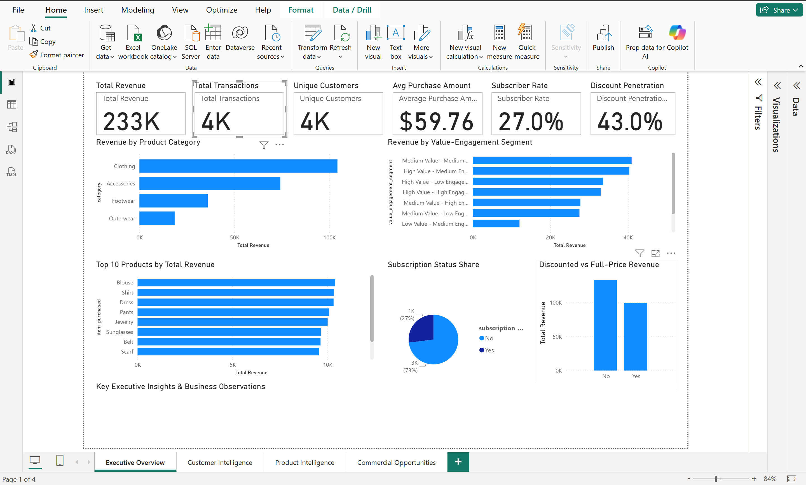
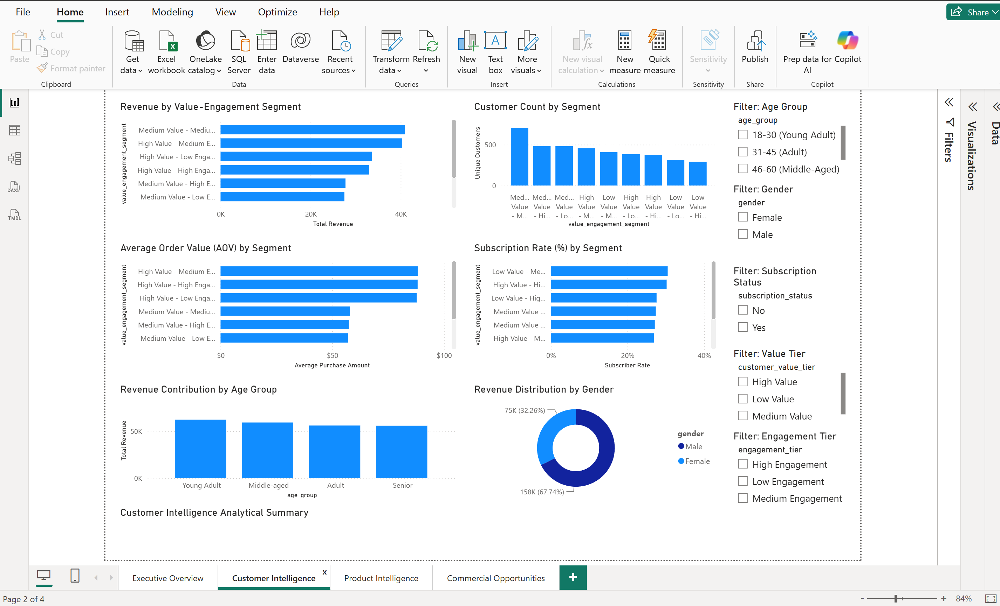
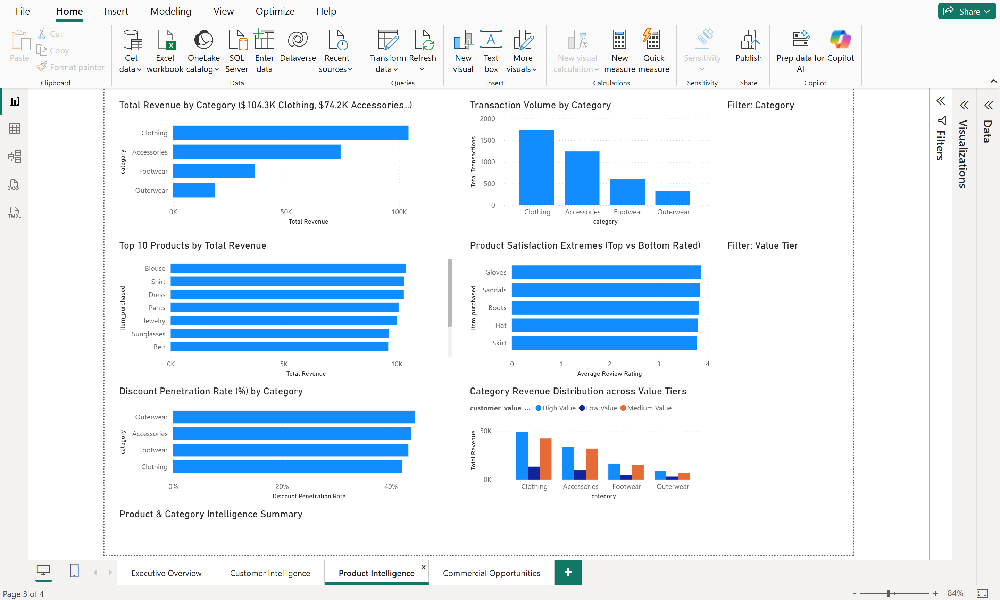
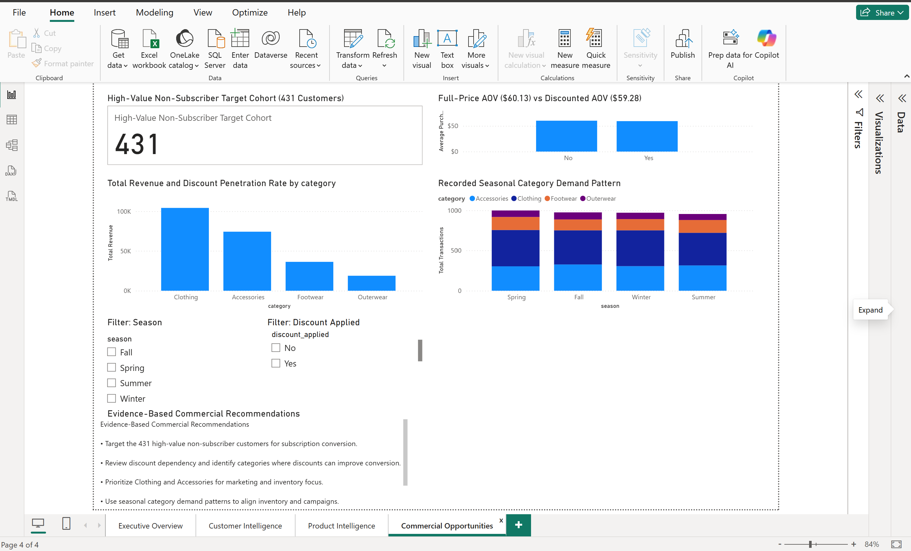

# Retail Customer & Product Intelligence

> An end-to-end retail analytics and business intelligence project transforming raw transactional data into an interactive decision-support solution using Python, SQL, and Power BI.


---

## Project Overview

The **Retail Customer & Product Intelligence** project analyzes retail customer and product purchasing behavior, uncovers customer segments and commercial transaction patterns, validates analytical KPIs across multiple data layers, and converts findings into actionable business recommendations through an interactive Power BI dashboard.

Operating on a retail customer transaction snapshot dataset of **3,900 unique customer records** across **25 products** and **4 categories**, the project addresses commercial challenges common to modern retail: identifying revenue concentration, measuring the financial impact of discounting, evaluating subscription adoption, spotting high-value non-subscriber conversion cohorts, and mitigating customer satisfaction risks in high-volume SKUs.

---

## 📊 Power BI Dashboard Preview

The completed project includes a four-page interactive Power BI dashboard that converts the underlying customer and product analysis into an interactive business decision-support interface.

### 1. Executive Overview



Executive-level view of revenue, transactions, customers, subscription rate, discount penetration, category performance, top products, and value-engagement segments.

### 2. Customer Intelligence



Customer segmentation and behavioral analysis covering value-engagement segments, customer count, AOV, subscription rate, age group, gender, and interactive customer filters.

### 3. Product Intelligence



Product and category analysis covering revenue, transaction volume, top products, satisfaction, discount penetration, and value-tier distribution.

### 4. Commercial Opportunities



Commercial opportunity analysis covering the 431 high-value non-subscriber target cohort, discount behavior, category opportunities, seasonal demand patterns, and evidence-based recommendations.

---

## Project Status

- **Analytical Pipeline**: 100% complete, fully verified, and reproducible.
- **SQL Business Intelligence Engine**: 100% complete across 14 relational queries.
- **KPI Reconciliation Audit**: 13/13 enterprise metrics reconciled with 100% agreement ($0.00 variance) across Python, SQL, and Power BI.
- **Power BI Dashboard**: 100% complete, interactive, and saved as [`customer_behavior_dashboard.pbix`](customer_behavior_dashboard.pbix) containing 4 dynamic analytical pages.
- **Readiness**: The repository represents the interview-ready final state of the project, structured for technical review and business case discussion.

---

## Key Enterprise Metrics at a Glance

| Analytical Metric | Value | Baseline Context |
| :--- | ---: | :--- |
| **Total Recorded Revenue** | **$233,081** | Total enterprise transaction revenue |
| **Total Transactions** | **3,900** | Cleaned transaction snapshot records |
| **Unique Customers** | **3,900** | 1 snapshot record per customer ID |
| **Average Purchase Amount (AOV)** | **$59.76** | Enterprise average order value |
| **Subscriber Count & Rate** | **1,053 (27.0%)** | Customers enrolled in subscription program |
| **Non-Subscriber Count & Rate** | **2,847 (73.0%)** | Non-enrolled customer base |
| **Discount Penetration Rate** | **43.0%** | 1,677 discounted orders vs. 2,223 full-price orders |
| **Top Category Revenue (Clothing)** | **$104,264** | 44.73% of total recorded revenue |
| **Top 2 Categories Revenue Share** | **76.56%** | Clothing ($104.3K) + Accessories ($74.2K) = $178.5K |
| **Top Revenue Product (Blouse)** | **$10,410** | 171 transactions, category: Clothing |
| **High-Value Non-Subscriber Cohort** | **431** | Repeat shoppers (>25 purchases, spend >$75, non-subscribed) |
| **Cross-Engine KPI Reconciliation** | **13/13 (100%)** | Exact agreement across Python, SQL, and Power BI ($0.00 variance) |

---

## End-to-End Analytical Workflow

```
Raw Retail Data (3,900 Records)
  │
  ▼
Python Data Cleaning & Feature Engineering
(Schema standardization, median imputation, age/value/engagement segmentation)
  │
  ▼
Descriptive Analysis / Customer & Product Intelligence
(Demographic spend distributions, SKU performance tracking, rating variance)
  │
  ▼
SQLite + SQL Business Analysis
(14 relational queries extracting transactional patterns across 4 domains)
  │
  ▼
Reconciliation & KPI Validation
(13/13 KPI audit matrix verifying 100% consistency across analytical engines)
  │
  ▼
Power BI Interactive Dashboard
(4 pages: Executive Overview, Customer Intel, Product Intel, Commercial Opps)
  │
  ▼
Business Insights
(Category concentration, AOV parity, discount dependency, SKU quality risks)
  │
  ▼
Commercial Recommendations
(5 evidence-based actions: subscriber conversion, discount review, merchandising focus)
```

### Layer-by-Layer Architectural Roles

1. **Python Layer (`generate_phase1_notebook.py`, Jupyter Notebook)**:
   - Ingests raw data (`customer_shopping_behavior.csv`).
   - Performs data hygiene: missing value imputation, column standardization, redundancy elimination.
   - Executes feature engineering: creates domain-specific attributes (`age_group`, `purchase_frequency_days`, `customer_value_tier`, `engagement_tier`, `value_engagement_segment`).
   - Generates exploratory descriptive statistics and exports processed datasets.

2. **SQLite / SQL Layer (`retail_bi.db`, `customer_behavior_sql_queries.sql`, `run_sql_analysis.py`)**:
   - Materializes the analytical dataset into a structured relational SQLite database.
   - Executes 14 business intelligence queries across customer, product, category, and commercial domains.
   - Extracts quantitative patterns, aggregations, and business baselines.
   - *Note on Governance*: SQL produces empirical analytical patterns; it does not independently "make recommendations." Those patterns are subsequently synthesized by analysts into business recommendations.

3. **Reconciliation / Validation Layer (`docs/sql_reconciliation_and_results.md`, `docs/power_bi_dashboard_documentation.md`)**:
   - Compares metrics calculated in Python with outputs from SQLite queries and Power BI DAX measures.
   - Confirms data pipeline integrity via a 13-point audit matrix with zero variance ($0.00 discrepancy).

4. **Power BI Visualization Layer (`customer_behavior_dashboard.pbix`)**:
   - Connects to the prepared data model.
   - Houses 15 explicit DAX measures protecting customer counting and revenue aggregation.
   - Provides a 4-page interactive visual dashboard with interactive slicers, cross-filtering, and strategic observation panels.

5. **Executive Strategy Layer (`docs/executive_business_report.md`)**:
   - Translates empirical dashboard findings into structured commercial actions organized by *Observation → Implication → Recommendation*.

---

## Python Data Cleaning & Feature Engineering

### Data Hygiene Actions
- **Column Standardization**: Normalized all headers to clean `snake_case`.
- **Missing Value Imputation**: Imputed missing `review_rating` entries using category-level median ratings (Clothing: 3.7, Accessories: 3.8, Footwear: 3.7, Outerwear: 3.65).
- **Collinearity Removal**: Dropped `promo_code_used` as it was 100% redundant with `discount_applied`.
- **Categorical Harmonization**: Standardized inconsistent frequency labels (`Fortnightly` → `Bi-Weekly`, `Every 3 Months` → `Quarterly`).

### Engineered Analytical Features
- **`age_group`**: Bins customer ages into 4 standard demographic brackets: `18-30 (Young Adult)`, `31-45 (Adult)`, `46-60 (Middle-Aged)`, and `61-70 (Senior)`.
- **`purchase_frequency_days`**: Encodes categorical frequency responses to numerical intervals (`Weekly` = 7, `Bi-Weekly` = 14, `Monthly` = 30, `Quarterly` = 90, `Annually` = 365).
- **`customer_value_tier`**: Segmented based on transaction spend:
  - `Low Value`: Spend < $40
  - `Medium Value`: Spend $40 to $75
  - `High Value`: Spend > $75
- **`engagement_tier`**: Segmented based on recorded historical purchase count:
  - `Low Engagement`: Previous purchases ≤ 15
  - `Medium Engagement`: Previous purchases 16 to 35
  - `High Engagement`: Previous purchases > 35
- **`value_engagement_segment`**: A 3x3 synthesized matrix combining Value Tier and Engagement Tier into 9 discrete operational segments (e.g., `High Value - High Engagement`, `Medium Value - Low Engagement`).

---

## SQL Business Intelligence Engine

The relational query library (`customer_behavior_sql_queries.sql`) contains **14 business queries** executed against `retail_bi.db`:

### Domain 1: Customer Intelligence
- **Q1: Value-Engagement Segment Revenue Contribution**: Evaluates revenue, customer count, AOV, and subscriber share across all 9 matrix segments.
- **Q2: Demographic Revenue Drivers Across Age & Gender**: Isolates volume vs. spend drivers across demographic groups.
- **Q3: Engagement Tier Volume vs. Spend Analysis**: Measures spend behavior across historical loyalty tiers.
- **Q4: Subscription Status Distribution Across Value Tiers**: Assesses subscription adoption across spend brackets.

### Domain 2: Product Intelligence
- **Q5: Category Commercial Performance Matrix & Revenue Ranking**: Calculates category revenue rank, transaction volume, AOV, ratings, and discount rates using window functions.
- **Q6: Top 10 Revenue-Generating Products**: Ranks individual catalog items by total sales dollars.
- **Q7: Product Satisfaction Extremes**: Identifies top 5 highest-rated vs. bottom 5 lowest-rated items to flag quality concerns.
- **Q8: Category Revenue Distribution Across Value Tiers**: Evaluates how high-, medium-, and low-spend customers distribute across categories.

### Domain 3: Commercial Intelligence
- **Q9: Promotional Impact on Order Value**: Directly compares average order value between full-price ($60.13) and discounted ($59.28) transactions.
- **Q10: Shipping Channel Monetization & Subscriber Share**: Analyzes delivery method preferences and premium shipping adoption.
- **Q11: Payment Method Revenue Contribution & Basket Sizes**: Evaluates revenue distribution across 6 payment types.
- **Q12: Seasonal Category Demand Pattern Matrix**: Maps quarterly category purchasing patterns to capture seasonal spikes.

### Domain 4: Strategic Opportunity Cohorts
- **Q13: High-Value Non-Subscriber Target Cohort**: Identifies the 431 target customers using multi-dimensional criteria.
- **Q14: Value-Oriented Merchandising Opportunities**: Highlights under-monetized product and segment intersections.

---

## Multi-Layer KPI Reconciliation & Validation

To ensure enterprise-grade analytical integrity, all core business KPIs were cross-audited across Python, SQLite (SQL), and Power BI (DAX). All **13 reconciliation checks** achieved **100% exact agreement ($0.00 variance)**:

| Check # | Analytical Dimension | Python Baseline | SQL Engine Result | Power BI DAX | Variance | Audit Status |
| :---: | :--- | :---: | :---: | :---: | :---: | :---: |
| **1** | Total Enterprise Revenue | $233,081 | $233,081 | $233,081 | $0.00 | **EXACT MATCH** |
| **2** | Transaction Volume | 3,900 orders | 3,900 orders | 3,900 orders | 0 | **EXACT MATCH** |
| **3** | Unique Customer Count | 3,900 customers | 3,900 customers | 3,900 customers | 0 | **EXACT MATCH** |
| **4** | Clothing Category Revenue | $104,264 | $104,264 | $104,264 | $0.00 | **EXACT MATCH** |
| **5** | Accessories Category Revenue | $74,200 | $74,200 | $74,200 | $0.00 | **EXACT MATCH** |
| **6** | Footwear Category Revenue | $36,093 | $36,093 | $36,093 | $0.00 | **EXACT MATCH** |
| **7** | Outerwear Category Revenue | $18,524 | $18,524 | $18,524 | $0.00 | **EXACT MATCH** |
| **8** | Subscriber Volume | 1,053 | 1,053 | 1,053 | 0 | **EXACT MATCH** |
| **9** | Non-Subscriber Volume | 2,847 | 2,847 | 2,847 | 0 | **EXACT MATCH** |
| **10** | Discounted Orders | 1,677 | 1,677 | 1,677 | 0 | **EXACT MATCH** |
| **11** | Full-Price Orders | 2,223 | 2,223 | 2,223 | 0 | **EXACT MATCH** |
| **12** | Top Product Revenue (Blouse) | $10,410 | $10,410 | $10,410 | $0.00 | **EXACT MATCH** |
| **13** | Target Non-Subscriber Cohort | 431 | 431 | 431 | 0 | **EXACT MATCH** |

---

## Power BI Interactive Dashboard

The interactive Power BI dashboard is completed, validated, and saved as [`customer_behavior_dashboard.pbix`](customer_behavior_dashboard.pbix). It is organized into **4 structured analytical pages** featuring dynamic visuals, explicit DAX measures, interactive slicers, and executive observation panels:

### Page 1 — Executive Overview
- **Executive KPI Cards**: Total Revenue ($233,081), Total Transactions (3,900), Unique Customers (3,900), Average Purchase Amount ($59.76), Subscriber Rate (27.0%), Discount Penetration Rate (43.0%).
- **Visuals**:
  - `Revenue by Product Category` (Clustered Bar Chart: Clothing $104.3K, Accessories $74.2K, Footwear $36.1K, Outerwear $18.5K).
  - `Top 10 Products by Total Revenue` (Horizontal Bar Chart: Blouse $10.4K to Shorts $9.4K).
  - `Revenue by Value-Engagement Segment` (Clustered Bar Chart across all 9 segments).
  - `Subscription Status Share` (Donut Chart: 1,053 Subscribed vs. 2,847 Non-Subscribed).
  - `Discounted vs. Full-Price Revenue` (Column Chart: $133.7K Full-Price vs. $99.4K Discounted).
- **Executive Insights Panel**: Synthesizes category concentration (76.56% in top 2 categories) and high-value tier contributions.

### Page 2 — Customer Intelligence
- **Visuals**:
  - `Revenue by Value-Engagement Segment` (Bar Chart).
  - `Customer Count by Segment` (Column Chart).
  - `Average Order Value (AOV) by Segment` (Bar Chart).
  - `Subscription Rate by Segment` (Bar Chart).
  - `Revenue Contribution by Age Group` (Column Chart: 18–30, 31–45, 46–60, 61–70).
  - `Revenue Distribution by Gender` (Donut Chart: 67.7% Male / 32.3% Female).
- **Interactive Slicers**: `Age Group`, `Gender`, `Subscription Status`, `Customer Value Tier`, `Engagement Tier`.
- **Customer Insights Panel**: Evaluates demographic volume representation vs. AOV parity ($59.54 Male vs. $60.25 Female).

### Page 3 — Product Intelligence
- **Visuals**:
  - `Total Revenue by Category` (Bar Chart).
  - `Transaction Volume by Category` (Column Chart).
  - `Top 10 Products by Total Revenue` (Horizontal Bar Chart).
  - `Product Satisfaction / Highest-Rated Product Analysis` (Grouped Column Chart: Top-rated Gloves 3.86 vs. Lowest-rated Shirt 3.62).
  - `Discount Penetration Rate by Category` (Bar Chart).
  - `Category Revenue Distribution across Value Tiers` (Stacked Column Chart).
- **Interactive Slicers**: `Category`, `Customer Value Tier`.
- **Product Insights Panel**: Flags satisfaction variance and high-volume SKU quality signals.

### Page 4 — Commercial Opportunities
- **Target Cohort KPI Card**: Highlights the **431 High-Value Non-Subscriber Target Cohort**.
- **Visuals**:
  - `Full-Price AOV vs. Discounted AOV` (Comparison Bar Chart: $60.13 Full-Price vs. $59.28 Discounted).
  - `Category Revenue vs. Discount Comparison` (Scatter / Dependency Matrix).
  - `Seasonal Category Demand Pattern` (Grouped Column Chart showing Spring/Winter Clothing peaks and Fall/Summer Accessories peaks).
- **Interactive Slicers**: `Season`, `Discount Applied`.
- **Commercial Recommendations Panel**: Details the 5 strategic initiatives for executive action.

### Canonical DAX Target Cohort Definition
The **431 High-Value Non-Subscriber Target Cohort** is defined dynamically in DAX as:

```dax
High-Value Non-Subscriber Opportunity Cohort = 
CALCULATE(
    COUNT(customer_shopping_behavior_cleaned[customer_id]),
    customer_shopping_behavior_cleaned[subscription_status] = "No",
    customer_shopping_behavior_cleaned[previous_purchases] > 25,
    customer_shopping_behavior_cleaned[purchase_amount_usd] > 75
)
```

*Criteria*: Isolates repeat retail customers with proven engagement (`previous_purchases > 25`) and premium current order spend (`purchase_amount_usd > 75`) who have not yet joined the subscription program (`subscription_status = "No"`).

---

## Key Business Insights

1. **Category Revenue Concentration**:
   - Clothing ($104,264) and Accessories ($74,200) account for **$178,464** or **76.56% of enterprise revenue**. Footwear (15.49%) and Outerwear (7.95%) make up the balance. Merchandising stability depends primarily on the top two categories.
2. **Subscription Adoption & Basket Parity**:
   - 27.0% of customers are subscribers (1,053 customers). However, subscribers exhibit virtually identical average order values to non-subscribers (**$59.65 vs. $59.80**). The commercial opportunity lies in growing subscription volume rather than assuming subscribers inherently spend more per single transaction.
3. **High-Value Non-Subscriber Opportunity**:
   - **431 customers** meet the high-value, highly engaged threshold without being enrolled in the subscription program, representing an immediate warm lead cohort for subscription marketing.
4. **Discount Penetration vs. Order Value**:
   - 43.0% of transactions were discounted (1,677 orders). Full-price orders averaged **$60.13** ($133.7K total), while discounted orders averaged **$59.28** ($99.4K total). Discounting is not expanding individual transaction ticket size in this dataset.
5. **Product Rating & Revenue Quality Signals**:
   - Top-volume SKUs show customer satisfaction friction: the `Shirt` ranks #2 in revenue ($10,332 across 169 orders) but has the lowest average rating in the catalog (**3.62 / 5.00**); the `Blouse` ranks #1 in revenue ($10,410 across 171 orders) with an average rating of **3.68 / 5.00**.
6. **Seasonal Demand Fluctuations**:
   - Clothing peaks in Spring ($27,477) and Winter ($26,903), whereas Accessories records its strongest sales in Fall ($19,531) and Summer ($18,877), providing concrete timing guidance for inventory planning.

---

## Evidence-Based Commercial Recommendations

1. **Target the 431 High-Value Non-Subscriber Customers for Subscription Conversion**:
   - *Action*: Deploy targeted loyalty campaigns offering exclusive benefits, free premium shipping, or early product access to convert these 431 repeat, high-spending shoppers into recurring subscribers.
2. **Review Outerwear's Discount Dependency**:
   - *Action*: Outerwear exhibits the highest category discount penetration (44.44%) despite contributing only 7.95% of total revenue ($18,524). Audit promotional margins to reduce unnecessary discounting depth on outerwear SKUs.
3. **Prioritize Clothing and Accessories in Merchandising**:
   - *Action*: Focus inventory allocation, working capital, and prime digital shelf space on Clothing and Accessories, which collectively drive 76.56% of total enterprise sales.
4. **Review Lower-Rated Products with High Revenue Contribution**:
   - *Action*: Initiate a product quality, fit, and returns audit on the `Shirt` (3.62 rating) and `Blouse` (3.68 rating) to protect revenue-generating hero items from customer churn.
5. **Align Seasonal Inventory and Marketing with Observed Category Demand Patterns**:
   - *Action*: Align procurement calendars and promotional schedules with seasonal demand cycles—prioritizing Clothing in Spring/Winter and Accessories in Fall/Summer.

---

## Analytical Limitations & Synthetic Data Properties

To maintain rigorous analytical standards, this project explicitly documents dataset boundaries:

1. **Absence of Transaction Timestamps**: The dataset contains snapshot-level transaction records without purchase dates. Time-series churn rate, cohort retention curves, and time-based Customer Lifetime Value (CLV) are not modeled.
2. **Snapshot Granularity**: Each record represents a single customer order snapshot. Multi-item cart analysis (market basket affinity modeling) is unsupported.
3. **Absence of Unit Cost & Margin Data**: Product cost of goods sold (COGS) and net profit margins are not present in the dataset; all financial analyses reflect recorded top-line revenue.
4. **Encoded Purchase Frequency**: `purchase_frequency_days` represents an encoded numerical mapping of survey-style categorical frequency responses, not longitudinal transaction intervals.
5. **Synthetic Data Properties**: Near-zero linear correlations across numerical fields (-0.02 to +0.02) reflect properties of synthetic benchmark data, handled by using non-linear segmentation and relational aggregation.

---

## Interview Talking Points

For technical interviewers and recruiters reviewing this case study, this project demonstrates competencies in:

- **End-to-End Data Analytics**: Owning the entire lifecycle from raw CSV ingestion through data modeling to executive presentation.
- **Data Engineering & Feature Engineering**: Designing domain-specific segmentation rules, median imputation, and categorical feature encoding in Python.
- **Relational Business Intelligence**: Authoring 14 complex SQL queries utilizing CTEs, window functions (`DENSE_RANK()`, `ROW_NUMBER()`), conditional aggregation, and multi-table joins.
- **Rigorous Cross-Engine Reconciliation**: Establishing a 13-point audit framework validating Python, SQL, and Power BI metrics with 100% agreement and zero variance.
- **Interactive Power BI Development**: Architecting a 4-page dashboard with custom DAX measures, dynamic slicers, visual formatting, and structured insight panels.
- **Commercial Acumen & Decision Support**: Translating raw data patterns into 5 structured, evidence-based business recommendations suitable for retail executive leadership.

---

## Repository File Structure

```
Retail-Customer-Product-Intelligence/
│
├── customer_behavior_dashboard.pbix           # Completed 4-page interactive Power BI dashboard
├── customer_shopping_behavior.csv             # Source raw transaction dataset (3,900 rows)
├── customer_behavior_sql_queries.sql          # 14 business intelligence SQL queries
├── build_powerbi_dashboard.py                 # PBIX layout generation script
├── run_sql_analysis.py                        # Automated SQL execution harness against SQLite
├── generate_phase1_notebook.py                # Reproducible notebook generation script
├── generate_phase4_assets.py                  # Presentation chart and slide generation engine
├── Customer_Shopping_Behavior_Analysis.ipynb  # Master Python data preparation & EDA notebook
├── CONTEXT.md                                 # Technical architecture & project ground-truth record
├── README.md                                  # Master project overview & executive case study
├── LICENSE                                    # MIT License
│
├── data/
│   └── processed/
│       ├── customer_shopping_behavior_cleaned.csv  # Canonical cleaned dataset (3,900 rows, 23 cols)
│       ├── customer_intelligence.csv              # Customer segmentation analytical table
│       ├── product_intelligence.csv               # Product performance matrix (25 products)
│       ├── category_intelligence.csv              # Category performance summary (4 categories)
│       └── retail_bi.db                           # SQLite analytical relational database
│
├── docs/
│   ├── dashboard_screenshots/                 # Power BI 4-page visual preview screenshots
│   ├── executive_business_report.md           # Formal executive analytics report
│   ├── power_bi_dashboard_documentation.md     # DAX taxonomy, visual map, & reconciliation audit
│   └── sql_reconciliation_and_results.md       # SQL reconciliation logs & query results
│
├── assets/
│   ├── eda_plots/                             # EDA visual dashboards (Parts 1 & 2)
│   └── phase4_charts/                         # High-resolution analytical charts
│
└── presentation/
    └── executive_presentation.md              # Executive slide deck narrative
```

---

## Technology Stack

| Category | Technologies Used |
| :--- | :--- |
| **Programming Language** | Python 3.13 |
| **Data Manipulation & Analysis** | Pandas, NumPy |
| **Data Visualization** | Matplotlib, Seaborn |
| **Relational Database & Querying** | SQLite 3, ANSI SQL / PostgreSQL syntax |
| **Business Intelligence & Modeling**| Microsoft Power BI Desktop, DAX (Data Analysis Expressions) |
| **Version Control & Collaboration** | Git, GitHub |

---

## Author

**Tanya Verma**  
*B.Tech. Computer Engineering, Thapar Institute of Engineering and Technology*

- **GitHub**: [github.com/tanyaverma20](https://github.com/tanyaverma20)
- **LinkedIn**: [linkedin.com/in/tanyaverma20](https://www.linkedin.com/in/tanyaverma20/)
